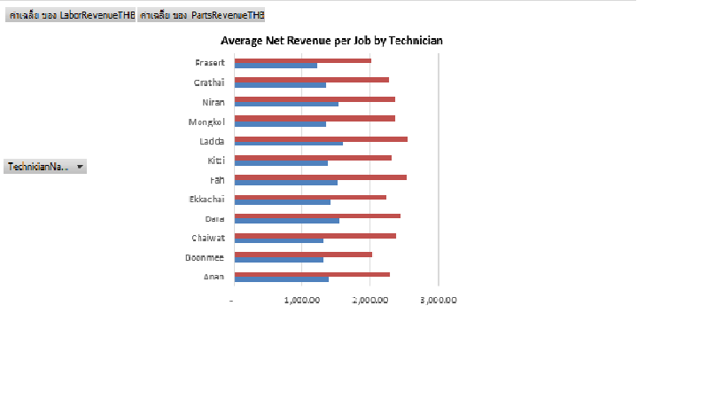

# Automotive Service Analytics

## Project Overview
This project analyzes automotive service operations using Excel PivotTables and PivotCharts.

The goal is to understand service revenue, labor revenue, parts revenue, and technician performance to support better business decisions.

## Tools Used
- Microsoft Excel
- PivotTables
- PivotCharts
- Data Analysis

## Business Questions
1. How much revenue comes from parts versus labor?
2. Which technicians generate the highest average revenue per job?
3. How does revenue vary across technicians?
4. What insights can help improve service operations?

## Key Findings
- Parts revenue is a major contributor to total service revenue.
- Ladda has the highest average net revenue per job among the technicians in this analysis.
- Revenue per job differs across technicians.
- Labor and parts revenue should be analyzed separately to understand the revenue structure.

## Dataset
This project uses a synthetic automotive service dataset created for learning and portfolio purposes. It does not contain real customer or business records.

## Project Status
- [x] Data exploration
- [x] Excel PivotTable analysis
- [x] Technician revenue comparison
- [x] PivotChart visualization
- [ ] SQL analysis
- [ ] Power BI dashboard

## Author
Aspiring Junior Data Analyst with hands-on automotive service experience.
## Dashboard Preview

## Revenue Analysis

### Key Insights
- Parts revenue accounts for approximately 62% of total revenue before discount.
- Labor revenue contributes approximately 38%.
- Parts revenue is the larger revenue component.

### Business Insight
The business generates a larger share of revenue from parts than labor. Management should monitor parts pricing, inventory availability, and gross margin.

*Note: This project uses synthetic data for portfolio purposes.*
### Engine Service Delay Analysis

The analysis identified Mongkol as the technician with the highest average delay among technicians handling at least five completed Engine jobs.

- Mongkol completed 7 Engine jobs, and all 7 were delayed (100%), with an average delay of 3.14 days.
- Anan also had a 100% delay rate across 6 jobs, averaging 2.83 days.
- Fah had a lower delay rate of 62.5% across 8 jobs, but delayed jobs still averaged 2.60 days.

**Business Recommendation:**

Investigate the underlying causes of delays for Mongkol and Anan, including repair complexity, parts availability, workload distribution, and diagnostic time. Review individual work orders before concluding that technician performance is the root cause.

*Note: The findings are based on a small sample of work orders and should be validated with additional data.*
